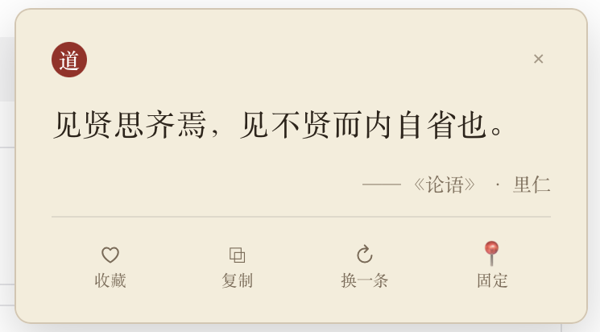

# 拾遗 · ShiYi

> 驻留菜单栏 / 托盘的经典语录小工具：在设定的时间窗内随机弹出一张语录卡片，
> 来自《道德经》《论语》《庄子》《孟子》《传习录》，共 265 条。

<p align="center">
  
</p>

## 特性

- **托盘常驻**：不占 Dock、不抢焦点，安静地待在菜单栏 / 系统托盘里
- **定时随机**：把设定的时间窗均分成若干段，每段随机取一个时刻弹出
- **不抢焦点**：卡片以 `focusable: false` 创建，弹出时当前应用的焦点不受影响
- **可扩展书库**：每本书是一个独立 JSON 文件，可以导入 / 导出 / 移除
- **收藏与历史**：收藏夹按书分栏浏览，历史保留最近 200 条
- **五种主题**：宣纸古典 / 水墨 / 竹简 / 夜读 / 青玉，另有「随机」
- **全局快捷键**：默认 `CmdOrCtrl+Shift+L`，可录制自定义组合键
- **界面样式**：跟随系统 / 亮色 / 暗色，切换即时生效
- **开机自启**：可选

### 托盘菜单

```
随机来一条
─────────
今日已弹 (N)   ›  ← 子菜单列出今天弹过的每条，点一下直接回看
下次弹出: MM-DD HH:MM
─────────
收藏夹 (N)
历史记录
书库 (N)
设置…
─────────
退出
```

「今日已弹」里的条目可以点击回看，回看**不会**重复记一条历史。
从收藏夹 / 历史里选一条同样不重复记历史——只有真正「弹出」才算一次。

## 语料

内置五本书，265 条：

| 书名 | 条数 |
| --- | ---: |
| 道德经 | 79 |
| 论语 | 78 |
| 庄子 | 33 |
| 孟子 | 40 |
| 传习录 | 35 |
| **合计** | **265** |

每条语录包含 `id` / `text` / `source`（书名）/ `book` / `chapter`（篇章）五个字段。
内置语料在 `src-tauri/quotes/*.json`，编译期由 `src-tauri/src/corpus.rs` 用
`include_str!` 嵌入；首次启动时迁移到书库目录，之后书库就是唯一的运行时来源。

修改内置语料后跑一次校验：

```bash
python3 scripts/validate_quotes.py
```

校验会检查各书条数、id 唯一性、正文重复、字段完整性、book/source 一致性等。

### 扩展语料

`语料/` 目录另存了 **67 本中国古典经典、7738 条**语录，每本一个 JSON 文件，
可以直接导入 app 的书库，不用改代码重新打包：

```bash
# 逐本导入：托盘菜单 →「书库」→ 底部「导入书籍…」
# 或者在终端里批量导入：
for f in 语料/*.json; do echo "$f"; done
```

书目见 [docs/语料书目.md](docs/语料书目.md)。这批语料只放在仓库里，
不编译进 app——所以内置语料仍是上表那 265 条。

排版风格与内置语料一致（全角标点、零引号、零括号），校验脚本：

```bash
python3 scripts/check_style.py --dir ./语料/
```

## 书库管理

托盘菜单里「书库」和「设置」同级，点开是一个独立窗口，可以**导入 / 导出 / 移除**书籍。

- **每本书一个文件**：书库目录下 `<书名>.json`，新增一本书就是多一个文件，
  不需要改代码或重新打包
- **导入**：选一个语料 JSON（`[{id, text, source, book, chapter}, ...]`），
  书名取自文件里语录的 `book` 字段，没有就退回文件名
- **导出**：把一本书写成 JSON，方便分享或备份
- **移除**：删掉这本书及其文件；它下面的收藏也一并清掉（否则收藏夹里会
  留下打不开的条目）

### 防止重复导入

两道校验，任意一道命中就拒绝并给出中文提示：

1. **同名**：书库里已经有同名书籍 → 「《X》已在书库中，未重复导入」
2. **内容指纹**：语录内容与已有某本书完全一致 → 「内容与《X》完全相同，未重复导入」

指纹只算 `id` + `text`，**不算书名**——所以把同一本书改个名字再导入，
照样会被第二道校验拦下。

### 书库文件格式

```
~/Library/Application Support/site.hancic.shiyi/books/
├── 道德经.json          # 一本书一个文件
├── 论语.json
├── 庄子.json
├── 孟子.json
├── 传习录.json
└── library.json         # 清单：记录被移除的内置书
```

`library.json` 用来记住「用户移除过哪些内置书」，否则内置书会在下次启动时
自动复活。手动加一个 JSON 文件到这个目录，下次启动也会被认出来。

## 测试

```bash
cargo test --manifest-path src-tauri/Cargo.toml   # 后端单测（语料 / 调度 / 存储 / 设置）
npm run build                                      # 前端类型检查 + 构建
python3 scripts/validate_quotes.py                 # 语料校验
```

后端单测覆盖：语料条数与字段完整性、时间窗分段与夏令时边界、
收藏 / 历史的持久化与上限、设置的落盘与回读、托盘文本的字符级截断、
书库的导入 / 导出 / 移除与重复导入拦截。

测试不会碰你的真实数据：测试构建下应用数据目录统一指向
`$TMPDIR/shiyi-test-data-<进程号>/`，跟 `~/Library/Application Support/`
里的收藏和设置完全隔开。

## 构建

需要 Rust ≥ 1.90、Node ≥ 20。

```bash
npm install
npm run tauri dev      # 开发
npm run tauri build    # 打包
```

产物在 `src-tauri/target/release/bundle/`：

- macOS：`拾遗.app`、`拾遗_<version>_aarch64.dmg`
- Windows：`拾遗_<version>_x64-setup.exe`、`拾遗_<version>_x64_zh-CN.msi`

### 图标

应用图标与菜单栏图标都由脚本生成，修改后重新跑一遍：

```bash
python3 make_icon.py        # 应用图标（多尺寸 + .icns + .ico）
python3 make_tray_icon.py   # 菜单栏 template icon
```

## 发布

打 `v*` tag 会触发 GitHub Actions 自动构建并发布多平台制品：

```
macOS arm64 → .dmg + .app.zip
macOS x64   → .dmg + .app.zip
Windows x64 → NSIS .exe + .msi
Windows x86 → NSIS .exe + .msi
```

见 `.github/workflows/release.yml`。工作流分三步：

1. **check** —— 在 `ubuntu-latest` 上跑前端类型检查、构建、`cargo test`
   与语料校验。跑 Rust 测试需要 WebKitGTK / GTK 这些系统库，镜像里
   没有，所以要先 `apt-get install`（workflow 里已经装好）。
2. **build** —— 按矩阵在四个平台上分别 `npx tauri build`。CI 环境下
   `CI=true` 会让 dmg 打包脚本跳过那段会超时的 Finder AppleScript。
   macOS 上 `.app` 是目录，先用 `ditto` 压成 zip 再上传（`ditto` 会
   保留符号链接与中文文件名的编码，`zip` 不会）。
   两种 macOS 架构都在 `macos-15`（arm64）runner 上构建，x64 走交叉编译
   ——`macos-14` 已退役，而 `macos-15` 的 x64 变体 `macos-15-intel`
   是付费镜像，公开 runner 里没有。
3. **release** —— 汇总各平台产物，创建 draft release，确认后再手动发布。

### 安装

macOS 版没有签名 / 公证，从 release 下载后首次打开会被 Gatekeeper 拦下。
两种绕过方式（任选其一）：

```bash
xattr -dr com.apple.quarantine /Applications/拾遗.app
```

或者在 Finder 里右键点应用 →「打开」→ 再确认一次「打开」。

Windows 的 NSIS 安装包和 MSI 未签名，SmartScreen 会提示「未知发布者」，
点「更多信息」→「仍要运行」即可。

发布物文件名带架构（`x64` / `x86` / `aarch64`），不同平台不会重名：

```
shiyi-macos-arm64.zip        shiyi-macos-x64.zip
shiyi_0.1.0_aarch64.dmg      shiyi_0.1.0_x64.dmg
shiyi_0.1.0_x64-setup.exe    shiyi_0.1.0_x86-setup.exe
shiyi_0.1.0_x64_zh-CN.msi    shiyi_0.1.0_x86_zh-CN.msi
```

GitHub 上传 release 资产时会剥掉文件名里的非 ASCII 字符，所以发布前
统一把「拾遗_」换成 `shiyi_`。而**本地** `npx tauri build` 出来的仍是
中文名（`拾遗.app` / `拾遗_0.1.0_aarch64.dmg`），只是发出去的那份改了名。

Windows 的 MSI 用 WiX 打包，默认代码页 1252 装不下中文，`productName`
是「拾遗」时 `light.exe` 会报 `LGHT0311`，所以
`tauri.conf.json` 里设了 `bundle.windows.wix.language: "zh-CN"`
（对应代码页 936）。

## 技术栈

- **桌面壳**：Tauri v2（Rust）
- **界面**：Vue 3 + TypeScript + Vite
- **插件**：`global-shortcut`（全局快捷键）、`autostart`（开机自启）、
  `store`、`clipboard-manager`、`dialog` + `fs`（书库导入导出）

## 项目结构

```
src-tauri/
├── quotes/            # 内置语料 JSON（按书分文件）
└── src/
    ├── lib.rs         # 命令、调度线程、托盘、快捷键
    ├── corpus.rs      # 运行时书库：加载、导入、导出、移除
    ├── quotes.rs      # 语录类型与展示
    ├── scheduler.rs   # 时间窗分段与随机排程
    ├── settings.rs    # 设置持久化
    ├── store.rs       # 收藏与历史持久化
    ├── macos.rs       # macOS 全屏浮层适配
    └── paths.rs       # 应用数据目录
src/
├── App.vue            # 按窗口 label 分发到不同面板
├── api.ts             # 后端命令封装
├── themes.ts          # 五套配色
└── components/        # 卡片、收藏夹、历史、设置、书库
```

## 数据存放

| 平台 | 路径 |
| --- | --- |
| macOS | `~/Library/Application Support/site.hancic.shiyi/` |
| Windows | `%APPDATA%\site.hancic.shiyi\` |

目录里有 `settings.json`（设置）、`data.json`（收藏 + 历史 + 触发记录）
和 `books/`（书库，每本书一个文件）。

## 许可

MIT，见 [LICENSE](LICENSE)。
